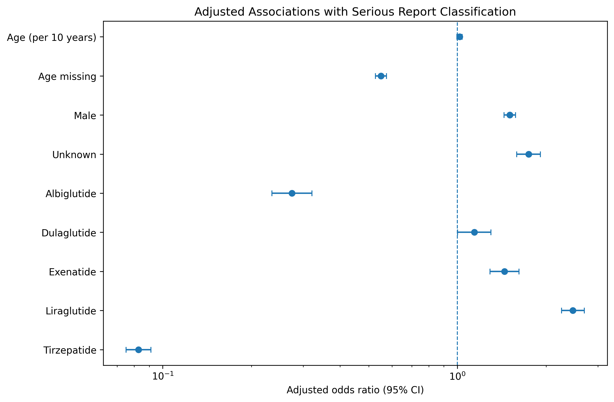
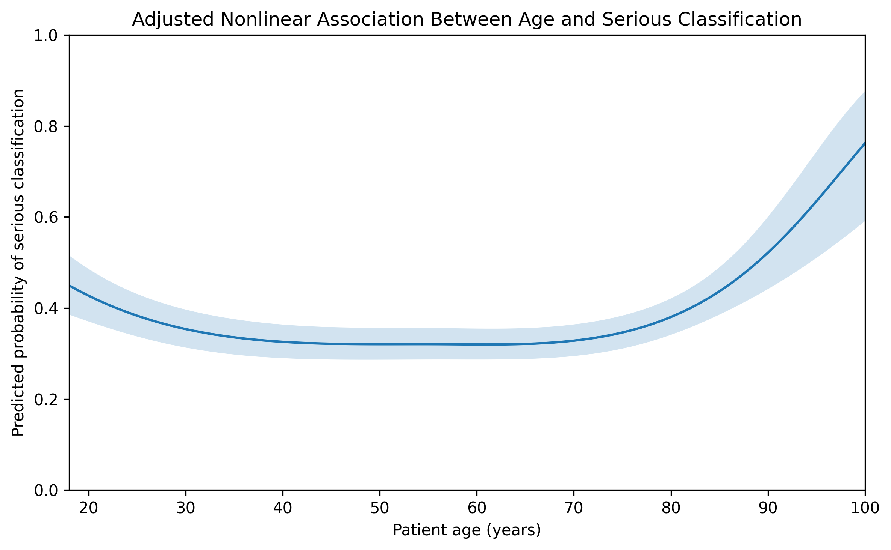
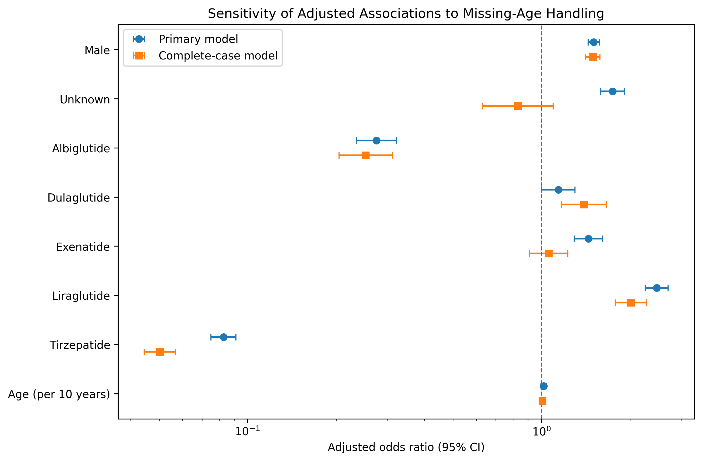

# Pharmacovigilance Analysis of GLP-1 Receptor Agonists Using FDA Adverse Event Reports

## Project Overview

This project analyzes FDA Adverse Event Reporting System (FAERS) data for GLP-1 receptor agonists to characterize adverse-event reporting patterns and investigate factors associated with serious report classification.

The analysis follows a complete pharmacovigilance workflow, including data preparation, exploratory analysis, within-class disproportionality analysis, temporal sensitivity analysis, and multivariable statistical modeling.

Because FAERS is a spontaneous-reporting system, the results are interpreted as exploratory reporting patterns rather than estimates of adverse-event incidence, causal drug effects, or comparative clinical safety.

## Research Question

**What patient, drug, and adverse-event characteristics are associated with serious report classification among reported GLP-1 receptor agonist adverse events?**

## Full Project Access

The complete analysis code and Jupyter notebooks are maintained in a private repository.
If you are interested in reviewing the full project, please contact me by email, and I would be happy to provide access to the repository.

## Dataset and Analytical Structure

The project uses a FAERS-derived dataset containing adverse-event reports associated with GLP-1 receptor agonists. The source data contain 149,209 reaction-level records representing 54,170 unique safety reports.

Because a single safety report can contain multiple reported reaction terms, the data were separated into two analytical datasets:

- **Report-level dataset:** 54,170 unique safety reports, used for patient characteristics, drug characteristics, seriousness classification,  temporal analyses, and statistical modeling.
- **Reaction-level dataset:** 149,209 reported reaction records, used to characterize reported reaction terms and perform pharmacovigilance  signal analyses.

The dataset includes seven GLP-1 receptor agonists: semaglutide, liraglutide, tirzepatide, exenatide, dulaglutide, albiglutide, and lixisenatide. Lixisenatide was represented by only 19 reports and was therefore excluded from the primary multivariable model because of its very small sample size.

Patient age was missing in 42.79% of reports and patient weight in 81.20%. These limitations informed subsequent modeling decisions, including the exclusion of weight from the primary model and sensitivity analysis for missing age.

### Data Source

The dataset used in this project was obtained from the Kaggle dataset

[GLP-1 Weight Loss Drugs Master Dataset 2017–2026 — Kaggle](https://www.kaggle.com/datasets/devtayyabsajjad/glp-1-weight-loss-drugs-master-dataset-2017-2026)

The adverse-event data are derived from the FDA Adverse Event Reporting System (FAERS) through the OpenFDA API. The primary source file used in this analysis,
 `adverse_events.csv`, contains adverse-event reports associated with GLP-1 receptor agonists.

## Analytical Workflow

The project is organized into four sequential Jupyter notebooks:

### 1. Data Preparation and Quality Assessment
`01_data_preparation.ipynb`

- Examines the structure and quality of the source data.
- Distinguishes report-level from reaction-level observations.
- Evaluates missingness, duplicate records, demographic variables, and potentially implausible values.
- Creates validated report-level and reaction-level analytical datasets for downstream analysis.

### 2. Exploratory Data Analysis
`02_exploratory_analysis.ipynb`

- Characterizes reporting patterns across drugs, calendar years, patient demographics, and reported reaction terms.
- Examines the distribution of serious and non-serious reports.
- Compares serious-report proportions across patient, drug, temporal, and reaction-term characteristics.
- Identifies important data limitations and candidate variables for multivariable modeling.

### 3. Pharmacovigilance Signal Analysis
`03_safety_signal_analysis.ipynb`

- Performs within-class disproportionality analysis using reporting odds ratios (RORs) with 95% confidence intervals.
- Screens drug–event combinations using minimum report-count and confidence-interval criteria.
- Examines frequently reported elevated signals separately for adequately represented GLP-1 receptor agonists.
- Uses calendar-year-stratified analysis to assess the sensitivity of selected signals to differences in temporal coverage.

### 4. Statistical Modeling
`04_statistical_modeling.ipynb`

- Models serious report classification using multivariable logistic regression.
- Adjusts simultaneously for patient age, age missingness, sex, generic drug, and reporting year.
- Evaluates nonlinearity in the age association using spline modeling.
- Uses complete-case analysis to assess sensitivity to missing age information.
- Reports adjusted odds ratios with 95% confidence intervals and emphasizes the limitations of causal or comparative safety interpretation.

## Key Findings

### Reporting Patterns

- The analytical dataset contained **54,170 unique safety reports** and **149,209 reported reaction records**.
- **28.62%** of reports were classified as serious.
- Female patients accounted for **63.44%** of reports, while male patients accounted for **30.60%**.
- Patient age was unavailable in **42.79%** of reports, highlighting substantial demographic missingness in the reporting data.
- Nausea was the most frequently reported reaction term, appearing in **7,629 reports (14.08%)**.

### Serious-Report Patterns

Serious-report proportions varied across patient characteristics, drugs, calendar years, and reported reaction terms.

Among adult age groups, the serious-report proportion increased from **27.50% among patients aged 18–44** to **43.20% among patients aged 75 years or older**. Male reports also had a higher serious-report proportion than female reports (**34.39% vs. 25.96%**).

These are descriptive patterns among submitted reports and should not be interpreted as population-level risks.

### Pharmacovigilance Signal Analysis

Within-class disproportionality analysis evaluated **11,093 observed drug–event pairs**. Using the primary exploratory criterion of at least five drug–event reports, an ROR greater than 1, and a lower 95% confidence bound greater than 1, **1,062 drug–event pairs met the exploratory screening criterion**.

A calendar-year-stratified sensitivity analysis was subsequently performed for 30 frequently reported elevated signals. **28 of 30** retained a lower 95% confidence bound above 1 after year stratification.

The analysis also showed that large RORs can occur for medication-use, device-related, and product-quality terms. ROR magnitude therefore should not be interpreted by itself as evidence of clinical importance or causal drug toxicity.

### Multivariable Statistical Modeling

The primary logistic regression model included **54,151 reports** and adjusted for patient age, age missingness, sex, generic drug, and reporting year.

Male reports had higher adjusted odds of serious classification than female reports (**OR 1.51; 95% CI 1.44–1.58**), and this association remained similar in the complete-case sensitivity analysis.

A single linear age term was close to the null (**OR per 10 years 1.02; 95% CI 1.00–1.04; p = 0.099**), but spline analysis demonstrated evidence of a nonlinear age association (**likelihood-ratio χ² = 64.87, df = 3, p < 0.001**).

Adjusted differences were also observed across drugs, but drug and calendar time were strongly intertwined. Some estimates changed materially in the complete-case sensitivity analysis, particularly for exenatide and reports with Unknown sex.

Overall, the results demonstrate associations within the submitted FAERS reports rather than causal effects, adverse-event incidence, or evidence that one GLP-1 receptor agonist is clinically safer than another.

## Methods and Tools

### Analytical Methods

- Data cleaning, validation, and missing-data assessment
- Report-level and reaction-level data restructuring
- Descriptive and exploratory data analysis
- Pharmacovigilance disproportionality analysis using reporting odds ratios (RORs) and 95% confidence intervals
- Calendar-year-stratified Mantel–Haenszel sensitivity analysis
- Multivariable logistic regression
- Restricted cubic spline modeling to evaluate nonlinear age associations
- Complete-case sensitivity analysis
- Data visualization and forest plots

### Technical Tools

- **Python**
- **pandas** and **NumPy** for data preparation and analysis
- **Matplotlib** for data visualization
- **statsmodels** for logistic regression and statistical inference
- **SciPy** for statistical testing
- **Jupyter Notebook** for reproducible analytical workflows
- **Git/GitHub** for version control and project presentation

## Key Visualizations

### Adjusted Associations With Serious Report Classification

The multivariable logistic regression model estimates adjusted associations between available report characteristics and serious classification while accounting simultaneously for age, age missingness, sex, generic drug, and reporting year.



### Nonlinear Association Between Age and Serious Classification

Spline modeling showed that the adjusted association between age and serious report classification was not adequately represented by a single linear coefficient. The modeled pattern decreased through younger adulthood, remained comparatively stable through much of middle age, and increased at older ages.



### Sensitivity to Missing-Age Handling

The primary model was compared with a complete-case model restricted to reports with observed age. Several associations remained relatively stable, while others changed substantially, demonstrating the importance of missing-data sensitivity analysis.



> **Interpretation:** These figures describe associations among submitted FAERS reports. They do not estimate population-level adverse-event risk, establish causality, or demonstrate that one GLP-1 receptor agonist is clinically safer than another.

## Limitations

This analysis has several important limitations inherent to spontaneous-reporting data:

- **FAERS reports do not provide an exposure denominator.** Reporting frequencies and odds ratios therefore cannot be interpreted as adverse-event 
  incidence or absolute risk.
- **Reported associations do not establish causality.** Reports are subject to stimulated reporting, underreporting, duplicate or incomplete
  information, differences in product use, and other reporting biases.
- **Drug comparisons are within this GLP-1 dataset.** The disproportionality analysis compares each drug with the other GLP-1 receptor agonists
  represented in the dataset rather than with the full FAERS database.
- **Drug and calendar time are strongly intertwined.** Differences between drugs may partly reflect differences in reporting periods, utilization,
  reporting behavior, and other temporal factors.
- **Important patient information is incomplete.** Age was missing in 42.79% of reports and weight in 81.20%, while other potential confounders such
  as indication, comorbidities, concomitant medications, and treatment duration were not available for the primary model.
- **Signal detection was exploratory.** The ROR screening was designed to identify reporting patterns for further investigation, not to confirm
  adverse drug reactions or establish comparative clinical safety.

The results should therefore be interpreted as **exploratory relative reporting patterns within this dataset**, rather than evidence of causal relationships, incidence rates, or comparative drug safety.

## Skills Demonstrated

This project demonstrates an end-to-end analytical workflow relevant to clinical, pharmaceutical, and healthcare data analysis, including:

- Cleaning, validating, and restructuring real-world pharmacovigilance data
- Performing exploratory analysis and communicating results through statistical visualization
- Applying pharmacovigilance disproportionality methods and interpreting RORs appropriately
- Building and interpreting multivariable logistic regression and nonlinear spline models
- Evaluating missing data, confounding, reporting bias, target leakage, and model sensitivity
- Communicating observational findings without overstating causal or comparative safety conclusions

## Repository Structure

```text
faers-pharmacovigilance-analysis/
├── README.md
└── figures/
    ├── adjusted_seriousness_forest_plot.png
    ├── adjusted_age_spline.png
    └── missing_age_sensitivity_forest_plot.png
```

## Reproducibility

The complete analytical workflow consists of four sequential Jupyter notebooks covering data preparation and quality assessment, exploratory data analysis, pharmacovigilance signal analysis, and multivariable statistical modeling.

The workflow has been tested by restarting the Python kernel and executing all four notebooks sequentially from the raw source data through the final statistical analyses and visualizations.